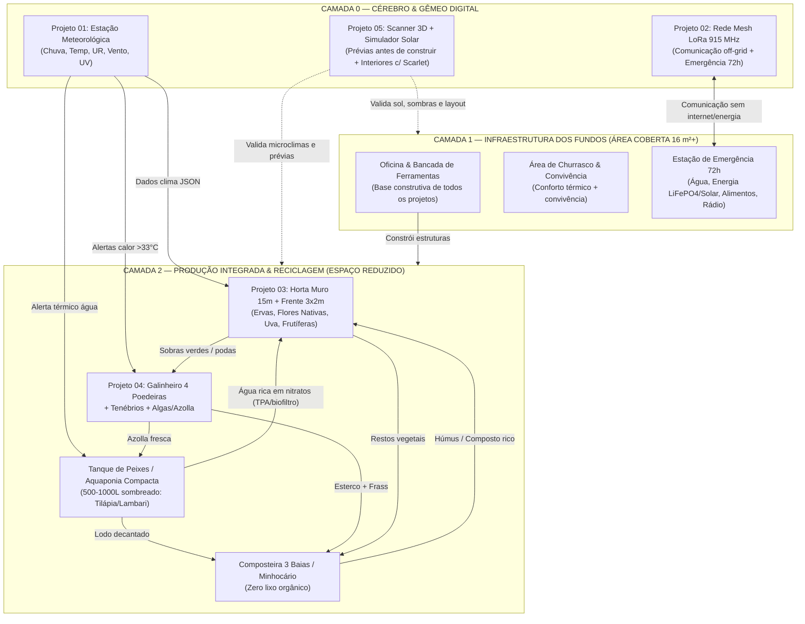

# Plano Mestre — Ecossistema Integrado Casa Maracaju 88 (Ribeirão Preto - SP)

> **Princípio Diretor:** *Primeiro a infraestrutura física (gêmeo digital, cobertura, oficina, hidráulica, elétrica e clima); depois a biologia (plantas, composteira, peixes e galinhas).*  
> **Clima-Alvo:** Tropical quente com inverno seco extremo (Ribeirão Preto — verões de 34–38 °C / 270 mm de chuva; invernos secos com UR < 25%).

---

## 1. Visão Sistêmica — A Casa Como Organismo Fechado em Espaço Reduzido

Em vez de projetos isolados competindo por metros quadrados, todos os módulos da **Casa Maracaju 88** trocam **água, nutrientes, sombra, energia e dados**:

---

## 2. Cronograma Lógico em 4 Fases ("Infraestrutura Primeiro")

### Fase 0 — Levantamento, Escaneamento e Prévias (Agora — Meses 1–2)
- Fotografar o **muro de 15 m**, o **canteiro frontal 3×2 m**, a **área dos fundos (16 m²)** e os **interiores**.
- Rodar o simulador **Maracaju 3D (`Projeto 05`)** para confirmar:
  1. Quanto a nova cobertura dos fundos vai sombrear o Setor C do muro esquerdo e o local do galinheiro/tanque de peixes no **solstício de inverno (21/Jun)** e no **solstício de verão (21/Dez)**.
  2. Onde deixar **faixas de telha translúcida/policarbonato UV** ou **beiral ventilado** para evitar "forno" sob a cobertura em Ribeirão Preto.
  3. Quais paredes/janelas internas recebem o sol mais pesado à tarde (para decisões conjuntas com a **Scarlet** sobre cortinas térmicas, brises, tinta térmica, layout e reformas).

### Fase 1 — Cobertura dos Fundos: Churrasco + Oficina + Emergência 72h (Base Construtiva)
A área coberta dos fundos (`~16 m²` ou mais) será o **coração multifuncional** da casa. Para não virar bagunça e não sofrer com o calor de Ribeirão Preto, a divisão sugerida em **3 zonas funcionais** (todas editáveis no Simulador 3D) é:

| Zona nos Fundos Cobertos | Área Estimada | Função & Requisitos de Engenharia |
| :--- | :---: | :--- |
| **1. Área de Churrasco & Convivência** | ~8,0 a 9,0 m² | Lado mais aberto e ventilado (fácil acesso vindo da casa). Telha **termoacústica (sanduíche 30 mm)** obrigatória (reduz 8–10 °C sob o telhado em RP!). Pia/bancada + ponto de água e esgoto. |
| **2. Oficina / Cantinho de Ferramentas** | ~3,5 a 4,0 m² | **Bancada robusta dobrável ou fixa (`1,60 × 0,65 m`)** com morsa, painel perfurado (*pegboard*) na parede para ferramentas manuais/elétricas, tomada **20A dedicada** (serra, furadeira, solda), iluminação LED 6500K forte e prateleira para parafusos/ESP32/PVC. **Fica pronta cedo para fabricar a horta, o tanque e o galinheiro!** |
| **3. Estação / Armário de Emergência 72h** | ~1,2 a 1,5 m² *(verticalizado!)* | Armário metálico/impermeável elevado do piso (protegido contra alagamento e sol direto, longe do calor da churrasqueira):  • **Água:** 2–3 galões alimentícios de 20 L (40–60 L rotacionados a cada 6 meses + filtro gravidade/hipoclorito). • **Energia:** Estação portátil / banco **LiFePO4 (12V 50–100Ah)** carregado pela placa solar do telhado ou rede, com inversor onda senoidal pura + saídas USB/12V para manter geladeira curta/roteador/celulares/bomba de ar dos peixes! • **Comunicação:** Nó **Meshtastic (`Projeto 02`)** + rádio AM/FM/VHF a pilha/dínamo + lanternas. • **Mantimentos & Primeiros Socorros:** Alimentos não perecíveis 72h (para 2 pessoas + reservas), fogareiro portátil a gás butano + refis, kit trauma/medicamentos essenciais, cópias offline de documentos. |

> [!TIP]
> **Sinergia de Ouro da Emergência 72h com os Peixes e o Projeto 02:**  
> Em um apagão prolongado de 12–72h em Ribeirão Preto, o **mesmo banco de baterias 12V LiFePO4** da Estação de Emergência 72h alimenta simultaneamente o nó **Meshtastic (Projeto 02)**, a **Estação Meteorológica (Projeto 01)** e o **compressor de ar 12V de emergência do Tanque de Peixes** (salvando todos os peixes de falta de oxigênio!).

### Fase 2 — Infraestrutura Invisível (Antes de Plantas e Animais!)
Aproveite a obra da cobertura dos fundos para deixar **tudo pré-passado** (custa fração do preço se feito na obra):
1. **Hidráulica:**
   - 1 ponto de água pressurizada com registro exclusivo para o **Manifold de Irrigação (Projeto 03)** no início/fim do muro de 15 m.
   - 1 ponto de água + **ralo/dreno** perto da área de transição (serve para lavagem rápida, TPA do tanque de peixes e abastecimento do galinheiro).
   - **Calha + cisterna compacta / bombona de 200 L** coletando água de chuva do telhado dos fundos (com tela anti-mosquito *Aedes* obrigatória!) para regar plantas e completar tanques.
2. **Elétrica & Dados (Padrão ESP32):**
   - 1 eletroduto PVC 3/4" levando energia protegida (DR + disjuntor exclusivo) para a bancada da oficina + tomada 12V/5V para os controladores ESP32 (Projetos 03 e 04) + bomba do tanque de peixes.
   - 1 eletroduto subindo até o telhado/cumeeira para o mastro compartilhado da **Estação Meteorológica (`01`) + Antena Mesh (`02`)** (com painel solar 30W voltado para o **Norte verdadeiro**).

### Fase 3 — Ciclos Biológicos Integrados (Implementação Modular Gradual)
Implemente na ordem que fizer sentido nos próximos meses — cada bloco se encaixa na infraestrutura já pronta:

1. **Módulo 3A — Horta & Irrigação 15 m + Pergolado 3×2 m (`Projeto 03`):**
   - Começa primeiro porque já reduz a temperatura do corredor lateral por evapotranspiração (efeito "ar-condicionado natural" no calor de Ribeirão Preto!).
2. **Módulo 3B — Composteira 3 Baias / Minhocário (Espaço: `1,20 × 0,50 m` na sombra):**
   - Recebe cascas da cozinha, podas da horta, esterco/cama das galinhas (Fase 3D) e lodo decantado do filtro dos peixes (Fase 3C).
   - Sempre em **local sombreado** (sol pleno de RP mata minhocas californianas acima de 30 °C!).
3. **Módulo 3C — Tanque de Peixes / Aquaponia Compacta (Espaço: `~1,50 × 1,20 m`):**
   - **Desafio de Ribeirão Preto:** água pequena no sol direto passa de 34 °C e perde oxigênio dissolvido!
   - **Solução técnica:** caixa d'água de PEAD de **500 L a 1.000 L** (ou IBC cortado com revestimento térmico/madeira) posicionada sob a **borda da cobertura dos fundos ou sombrite 70%**, com:
     - **Espécies recomendadas para espaço reduzido e calor:** **Tilápia-do-Nilo** (muito resistente até 32 °C, crescimento rápido) ou **Lambari / Pacu-peva** (ainda mais compacto) + **guppies** no tanque de Azolla (controle anti-dengue).
     - **Biofiltro compacto (decantador + mídia biológica K1/argila expandida)** + bomba submersa econômica (15–30 W) + **nobreak 12V / bomba de ar solar de backup**!
     - **Integração com a Horta:** a troca parcial de água (TPA — 10% a 15%/semana) é bombeada por gravidade ou mini-bomba direto para as frutíferas/horta (adubo líquido natural rico em nitrato, zero desperdício de água!).
     - **Sensoriamento ESP32:** sonda `DS18B20` (temperatura da água) + alerta automático se passar de 31 °C ou se faltar energia na bomba.
4. **Módulo 3D — Galinheiro Elevado + Tenébrios + Algas/Azolla (`Projeto 04`):**
   - Instalado na transição fundo/corredor onde entra sol da manhã (8h–12h) e sombra à tarde.
   - A **Torre de Tenébrios** fica no canto mais fresco da área coberta (longe do calor da churrasqueira e do sol).
   - A **Azolla** alimenta tanto as **4 galinhas** quanto as **tilápias** (proteína gratuita gerada pelo sol de Ribeirão Preto!).

---

## 3. Interiores & Decisões Conjuntas (Matheus & Scarlet)

Dentro da casa vagão (onde a Scarlet lidera as decisões estéticas e funcionais), o **Projeto 05** atua como ferramenta prática de diálogo visual ("ver antes de quebrar ou comprar"):
- **Simulação de Calor & Luz Natural:** no Simulador 3D, o **Modo Raio-X** remove o telhado e mostra qual parede/janela leva sol direto às 15h–17h no verão (paredes voltadas para Oeste/Sudoeste em Ribeirão Preto acumulam calor que irradia para os quartos à noite!).
- **Teste de Reformas em Escala Real:** com o scan interno (via Scaniverse / MagicPlan / Sweet Home 3D), vocês podem testar juntos:
  - Posição de móveis, prateleiras, iluminação indireta e ventilação cruzada;
  - Integração visual entre a cozinha/sala e a nova área coberta dos fundos (churrasco separado visualmente da bancada de ferramentas e do armário 72h usando divisória ripada ou armário fechado bonito!).
- **Estúdio de Prévia sobre Foto:** antes de pendurar qualquer floreira, treliça, prateleira ou painel no muro ou dentro de casa, vocês sobem a foto real no navegador, arrastam os elementos e salvam a prévia em PNG para aprovar juntos!
